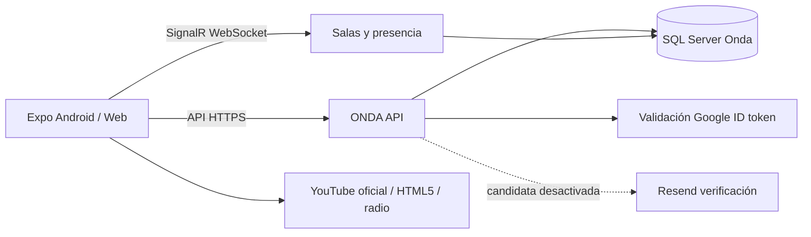

# Arquitectura comprobada: producción y candidata

Producción: **0.6.1**, código `31f5360`, imagen `onda-api:20261014-061-safety-sync`.
Documentación de publicación: `141d14a`. Candidata en esta rama: **0.6.2**, no publicada.

Frontend: Expo 57.0.28, RN 0.86.3, React 19.2.3, TypeScript 6.0.3; Expo Router en `app/`.
TanStack Query conserva consultas por cuenta; Zustand sesión/preferencias; almacenamiento seguro
nativo para token, sessionStorage en web. Código privado de recuperación permanece solo en memoria.
Reanimated y tema ONDA con opciones claro/oscuro; retratos remotos Google con fallback de iniciales.

Backend: .NET 10, Minimal APIs, EF Core SQL Server, SignalR sobre WebSocket y tareas de mantenimiento.
Contabo, contenedor API propio dentro de servidor compartido, Caddy y Cloudflare existentes.

SQL almacena `ListenerAccounts` (cuentas/foto URL/contraseña hasheada), `ListenerSessions` (huellas de
tokens y vencimiento), `CloudLibraries`, salas/cola, chat, bloqueos y reportes. Las cuentas no viven en
Cloudflare ni en el emulador: este conserva una sesión local. La base está en el VPS Contabo.

Los datos públicos de salas son comunes a todas las cuentas. No significan que Google comparta identidad.
La candidata oculta salas vacías del descubrimiento, mantiene las del propietario para retomarlas y
limita la creación a una sala abierta. Salas antiguas múltiples no se eliminan automáticamente.

Autenticación: invitado, correo/contraseña y Google firmado, audiencia/expiración/correo/nonce validado;
vinculación por `sub`. Un correo coincidente no permite apropiarse de una cuenta con contraseña.
La candidata confirma emails por token aleatorio hasheado de un solo uso, cuando se habilite remitente.
No se marca el correo de cuentas antiguas como confirmado sin evidencia; Google conserva su verificación.

Chat: texto, stickers/emoji, respuestas, edición/borrado, pins/reacciones, typing, historial paginado.
Adjuntos nuevos siguen bloqueados por servidor. Reportes/bloqueos persistentes; moderador solo por allowlist.
Presencia/fan-out son de una instancia. Escalado horizontal exige rediseñar locks/presencia/coordinación.
